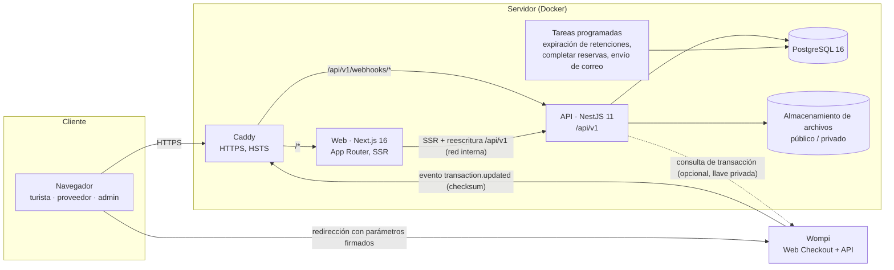

# Arquitectura

## Vista de componentes

## Decisiones principales

| Tema | Decisión | ADR |
|---|---|---|
| Estructura | Monorepo pnpm y Turborepo con `apps/api`, `apps/web` y `packages/contracts` | [0001](adr/0001-monorepo-y-stack.md) |
| Persistencia | PostgreSQL 16 y Prisma 6, con restricciones de integridad en la base (CHECK, índices parciales, trigger) | [0002](adr/0002-postgresql-prisma.md) |
| Sesión | Token opaco en cookie HttpOnly y SameSite=Lax; la base guarda solo su hash SHA-256; CSRF de doble envío | [0003](adr/0003-sesiones-y-csrf.md) |
| Dinero | Enteros COP; comisión en puntos básicos; foto de precios en cada reserva | [0004](adr/0004-dinero-y-comision.md) |
| Pagos | Wompi Web Checkout; la fuente de verdad es el webhook firmado; reembolsos registrados manualmente | [0005](adr/0005-pagos-wompi.md) |
| Contabilidad | Libro contable de solo inserción con claves de idempotencia; liquidaciones manuales | [0006](adr/0006-libro-contable.md) |
| Inventario | `UPDATE` condicional atómico más CHECK; retención con expiración | [0007](adr/0007-inventario.md) |
| Archivos | Disco local con validación por firma binaria; separación público/privado; S3 pendiente | [0008](adr/0008-archivos.md) |
| Imágenes | Ilustraciones SVG originales en lugar de fotos sin licencia | [0009](adr/0009-ilustraciones.md) |

## Mismo origen

El navegador solo habla con la web. Next.js reenvía `/api/v1/*` a la API por la red interna. Esto da tres ventajas:

- Las cookies de sesión son *first-party*.
- No se necesita CORS abierto.
- La política CSP queda en `connect-src 'self'`.

Los componentes de servidor de Next.js llaman a la API directamente con la cookie del visitante. Solo el webhook de Wompi entra a la API sin pasar por la web.

## Contratos compartidos

`@travelcol/contracts` contiene los esquemas Zod de todas las entradas, los enums, las etiquetas en español, las políticas de cancelación y los tipos de respuesta. Esos esquemas se usan en tres lugares:

- En la API, como validación estricta (`ZodPipe`): se rechazan los campos desconocidos.
- En la especificación OpenAPI, convertidos a JSON Schema.
- En la web, como validación de formularios con react-hook-form.

Así la interfaz y el servidor no pueden divergir. La API siempre revalida.

## Módulos de la API

| Módulo | Responsabilidad |
|---|---|
| `auth` | Registro, ingreso con bloqueo por intentos, sesiones, verificación de correo y recuperación |
| `catalog` | Catálogo público y gestión de experiencias, fotos y disponibilidad por el proveedor |
| `providers` | Solicitudes, perfil, documentos privados, reservas y finanzas del proveedor |
| `bookings` | Creación con cotización en servidor, retención de inventario, cancelación y estados |
| `payments` | Checkout firmado, webhook idempotente, conciliación y pagos tardíos |
| `finance` | Libro contable, saldos y liquidaciones |
| `reviews` | Reseñas verificadas |
| `admin` | Operación, moderación, finanzas, usuarios, configuración, auditoría y reportes |
| `support` | PQR con radicado y versiones de textos legales |
| `notifications` | Notificaciones internas y bandeja de salida de correo (`email_outbox`) |
| `jobs` | Expiración de retenciones, reservas completadas y envío de correo |
| `health` | `/health` (vivo) y `/health/ready` (base de datos y pagos pendientes antiguos) |

## Límites conocidos de esta versión

- **Un solo nodo de API.** El limitador de tasa vive en memoria y las tareas programadas corren dentro del proceso. Para escalar horizontalmente hace falta Redis para el limitador y una tarea líder o una cola. Ver [brecha-a-produccion.md](brecha-a-produccion.md).
- **Archivos en disco local** (volumen Docker). Para varios nodos hace falta almacenamiento de objetos.
- **Correo:** el controlador `log` deja los mensajes en `email_outbox` sin enviarlos.
