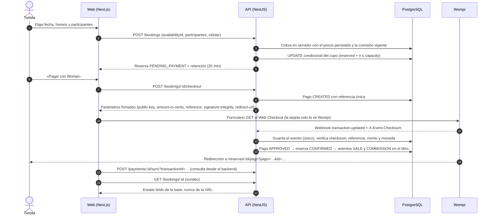
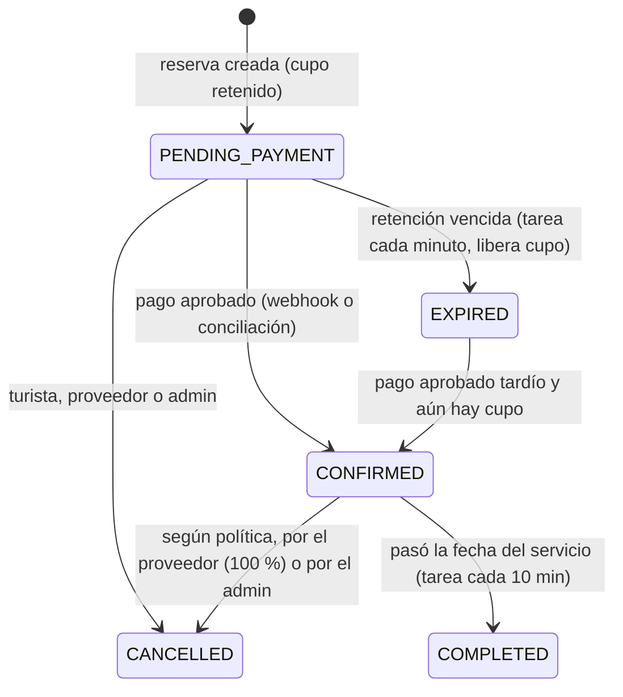
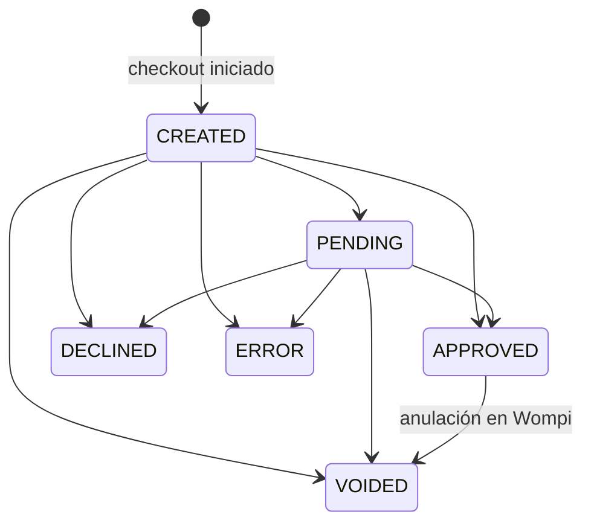

# Flujo de reservas y pagos

## Secuencia completa

## Estados de la reserva

Las transiciones viven en `apps/api/src/domain/booking-state.ts`. Cada cambio queda en `booking_status_history` con su actor y su motivo. Ninguna transición se puede pedir directamente desde el navegador.

## Estados del pago

Los eventos repetidos o fuera de orden no hacen retroceder un estado final. Por ejemplo, un `PENDING` que llega después de `APPROVED` se registra como `STALE` y no tiene efecto.

## Inventario sin sobreventa

1. La reserva y la retención ocurren en una transacción con `UPDATE service_availability SET reserved_count = reserved_count + n WHERE id = … AND status = 'OPEN' AND reserved_count + n <= capacity`. Si no se actualiza ninguna fila, no hay cupo y se responde `409`.
2. Un `CHECK` en la base impide `reserved_count > capacity` aunque algún código lo intentara.
3. Al expirar, cancelar o anular un pago, el cupo se libera en la misma transacción que cambia el estado.
4. Prueba: 12 solicitudes concurrentes por el último cupo producen exactamente 1 reserva (`bookings-payments.spec.ts`).

## Webhook: validaciones en orden

| # | Validación | Resultado si falla |
|---|---|---|
| 1 | Registrar el evento una sola vez (`event_key` = SHA-256 de checksum + datos + marca de tiempo) | `DUPLICATE`, `200`, sin efecto |
| 2 | Checksum SHA-256 de `signature.properties` + `timestamp` + secreto de eventos, comparado en tiempo constante con el cuerpo y con `X-Event-Checksum` | `INVALID_SIGNATURE`, `401` |
| 3 | Tipo de evento `transaction.updated` | `IGNORED_EVENT`, `200` |
| 4 | Ambiente coherente (`test` en Sandbox, `prod` en producción) | `MISMATCH`, `200` |
| 5 | La referencia existe | `UNKNOWN_REFERENCE`, `200`, queda registrado |
| 6 | Monto en centavos y moneda COP iguales a lo esperado | `MISMATCH`; la reserva se marca “requiere atención” |
| 7 | Opcional (`WOMPI_VERIFY_WITH_API=true`): confirmar la transacción en la API de Wompi con la llave privada | `NOT_VERIFIABLE`, `503`, para que Wompi reintente |
| 8 | Transición válida del pago y de la reserva | `STALE` si no aplica |

## Casos borde cubiertos

| Caso | Comportamiento |
|---|---|
| El turista vuelve con `?status=APPROVED` en la URL | Se ignora. La página consulta el estado al backend (prueba E2E 8) |
| Pago aprobado después de expirar la reserva | Intenta recuperar el cupo de forma atómica. Si no hay cupo, crea un reembolso del 100 %, marca la reserva y avisa a administración |
| Pago aprobado de una reserva cancelada | Reembolso del 100 % pendiente y aviso a administración |
| Pago aprobado y luego anulado (`VOIDED`) | La reserva se cancela, se libera el cupo y se marca para revisión contable |
| Pago rechazado | El turista puede reintentar mientras la retención siga vigente; cada intento usa una referencia nueva |
| Doble pago aprobado para la misma reserva | El índice único parcial lo impide; el segundo pago se trata como discrepancia |
