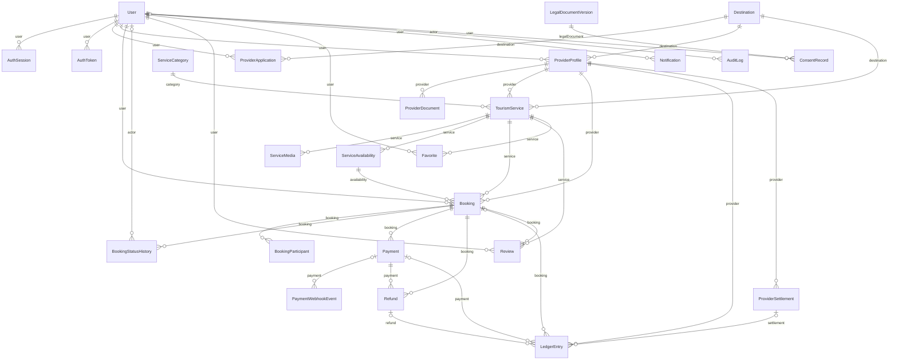

# Modelo de datos (generado)

> Archivo generado por `scripts/docs/gen-data-dictionary.py` a partir de `apps/api/prisma/schema.prisma`. No editar a mano.
> 28 tablas · 21 enumeraciones. Las restricciones CHECK, índices parciales y el trigger del libro contable están en la migración inicial (ver `modelo-de-datos.md`).

## Diagrama entidad-relación

## Diccionario de datos

### User → `users`

| Campo | Columna | Tipo | Nulo | Por defecto | Notas |
|---|---|---|---|---|---|
| id | `id` | String (Uuid) | no | uuid() | PK |
| email | `email` | String (VarChar(254)) | no |  | único |
| passwordHash | `password_hash` | String | no |  |  |
| fullName | `full_name` | String (VarChar(120)) | no |  |  |
| phone | `phone` | String (VarChar(20)) | sí |  |  |
| role | `role` | UserRole | no | TOURIST | enum: TOURIST / PROVIDER / SUPPORT / ADMIN |
| status | `status` | UserStatus | no | ACTIVE | enum: ACTIVE / SUSPENDED |
| emailVerifiedAt | `email_verified_at` | DateTime (Timestamptz(3)) | sí |  |  |
| marketingOptIn | `marketing_opt_in` | Boolean | no | false |  |
| failedLoginCount | `failed_login_count` | Int | no | 0 |  |
| lockedUntil | `locked_until` | DateTime (Timestamptz(3)) | sí |  |  |
| lastLoginAt | `last_login_at` | DateTime (Timestamptz(3)) | sí |  |  |
| createdAt | `created_at` | DateTime (Timestamptz(3)) | no | now() |  |
| updatedAt | `updated_at` | DateTime (Timestamptz(3)) | no |  | auto (actualización) |

Índices: `@@index([role, status])`

### AuthSession → `auth_sessions`

| Campo | Columna | Tipo | Nulo | Por defecto | Notas |
|---|---|---|---|---|---|
| id | `id` | String (Uuid) | no | uuid() | PK |
| userId | `user_id` | String (Uuid) | no |  |  |
| tokenHash | `token_hash` | String (Char(64)) | no |  | único |
| expiresAt | `expires_at` | DateTime (Timestamptz(3)) | no |  |  |
| revokedAt | `revoked_at` | DateTime (Timestamptz(3)) | sí |  |  |
| lastSeenAt | `last_seen_at` | DateTime (Timestamptz(3)) | no | now() |  |
| userAgent | `user_agent` | String (VarChar(255)) | sí |  |  |
| ipHash | `ip_hash` | String (Char(64)) | sí |  |  |
| createdAt | `created_at` | DateTime (Timestamptz(3)) | no | now() |  |

Relaciones: `userId` → User

Índices: `@@index([userId, revokedAt])`; `@@index([expiresAt])`

### AuthToken → `auth_tokens`

| Campo | Columna | Tipo | Nulo | Por defecto | Notas |
|---|---|---|---|---|---|
| id | `id` | String (Uuid) | no | uuid() | PK |
| userId | `user_id` | String (Uuid) | no |  |  |
| type | `type` | AuthTokenType | no |  | enum: EMAIL_VERIFICATION / PASSWORD_RESET |
| tokenHash | `token_hash` | String (Char(64)) | no |  | único |
| expiresAt | `expires_at` | DateTime (Timestamptz(3)) | no |  |  |
| usedAt | `used_at` | DateTime (Timestamptz(3)) | sí |  |  |
| createdAt | `created_at` | DateTime (Timestamptz(3)) | no | now() |  |

Relaciones: `userId` → User

Índices: `@@index([userId, type])`

### ProviderApplication → `provider_applications`

| Campo | Columna | Tipo | Nulo | Por defecto | Notas |
|---|---|---|---|---|---|
| id | `id` | String (Uuid) | no | uuid() | PK |
| userId | `user_id` | String (Uuid) | no |  |  |
| businessName | `business_name` | String (VarChar(120)) | no |  |  |
| legalName | `legal_name` | String (VarChar(160)) | no |  |  |
| taxId | `tax_id` | String (VarChar(20)) | no |  |  |
| rntNumber | `rnt_number` | String (VarChar(10)) | sí |  |  |
| contactPhone | `contact_phone` | String (VarChar(20)) | no |  |  |
| description | `description` | String | no |  |  |
| destinationId | `destination_id` | String (Uuid) | no |  |  |
| status | `status` | ApplicationStatus | no | PENDING | enum: PENDING / APPROVED / REJECTED |
| reviewNotes | `review_notes` | String | sí |  |  |
| reviewedById | `reviewed_by_id` | String (Uuid) | sí |  |  |
| reviewedAt | `reviewed_at` | DateTime (Timestamptz(3)) | sí |  |  |
| createdAt | `created_at` | DateTime (Timestamptz(3)) | no | now() |  |

Relaciones: `userId` → User; `destinationId` → Destination

Índices: `@@index([status, createdAt])`; `@@index([userId])`

### ProviderProfile → `provider_profiles`

| Campo | Columna | Tipo | Nulo | Por defecto | Notas |
|---|---|---|---|---|---|
| id | `id` | String (Uuid) | no | uuid() | PK |
| userId | `user_id` | String (Uuid) | no |  | único |
| slug | `slug` | String (VarChar(140)) | no |  | único |
| businessName | `business_name` | String (VarChar(120)) | no |  |  |
| legalName | `legal_name` | String (VarChar(160)) | no |  |  |
| taxId | `tax_id` | String (VarChar(20)) | no |  | único |
| rntNumber | `rnt_number` | String (VarChar(10)) | sí |  |  |
| rntVerifiedAt | `rnt_verified_at` | DateTime (Timestamptz(3)) | sí |  |  |
| contactPhone | `contact_phone` | String (VarChar(20)) | no |  |  |
| description | `description` | String | no |  |  |
| destinationId | `destination_id` | String (Uuid) | no |  |  |
| status | `status` | ProviderStatus | no | PENDING_REVIEW | enum: PENDING_REVIEW / APPROVED / SUSPENDED |
| isDemo | `is_demo` | Boolean | no | false |  |
| createdAt | `created_at` | DateTime (Timestamptz(3)) | no | now() |  |
| updatedAt | `updated_at` | DateTime (Timestamptz(3)) | no |  | auto (actualización) |

Relaciones: `userId` → User; `destinationId` → Destination

Índices: `@@index([status])`

### ProviderDocument → `provider_documents`

| Campo | Columna | Tipo | Nulo | Por defecto | Notas |
|---|---|---|---|---|---|
| id | `id` | String (Uuid) | no | uuid() | PK |
| providerId | `provider_id` | String (Uuid) | no |  |  |
| type | `type` | ProviderDocumentType | no |  | enum: RNT / RUT / CAMARA_COMERCIO / IDENTIFICACION / POLIZA / OTRO |
| storageKey | `storage_key` | String | no |  | único |
| originalName | `original_name` | String (VarChar(200)) | no |  |  |
| mimeType | `mime_type` | String (VarChar(60)) | no |  |  |
| sizeBytes | `size_bytes` | Int | no |  |  |
| sha256 | `sha256` | String (Char(64)) | no |  |  |
| status | `status` | DocumentStatus | no | PENDING | enum: PENDING / VERIFIED / REJECTED |
| reviewNotes | `review_notes` | String | sí |  |  |
| reviewedById | `reviewed_by_id` | String (Uuid) | sí |  |  |
| reviewedAt | `reviewed_at` | DateTime (Timestamptz(3)) | sí |  |  |
| createdAt | `created_at` | DateTime (Timestamptz(3)) | no | now() |  |

Relaciones: `providerId` → ProviderProfile

Índices: `@@index([providerId, type])`; `@@index([status])`

### Destination → `destinations`

| Campo | Columna | Tipo | Nulo | Por defecto | Notas |
|---|---|---|---|---|---|
| id | `id` | String (Uuid) | no | uuid() | PK |
| slug | `slug` | String (VarChar(80)) | no |  | único |
| name | `name` | String (VarChar(120)) | no |  |  |
| department | `department` | String (VarChar(80)) | no |  |  |
| summary | `summary` | String (VarChar(300)) | no |  |  |
| description | `description` | String | no |  |  |
| isPilot | `is_pilot` | Boolean | no | false |  |
| isActive | `is_active` | Boolean | no | true |  |
| createdAt | `created_at` | DateTime (Timestamptz(3)) | no | now() |  |

### ServiceCategory → `service_categories`

| Campo | Columna | Tipo | Nulo | Por defecto | Notas |
|---|---|---|---|---|---|
| id | `id` | String (Uuid) | no | uuid() | PK |
| slug | `slug` | String (VarChar(80)) | no |  | único |
| name | `name` | String (VarChar(80)) | no |  |  |
| description | `description` | String (VarChar(300)) | no |  |  |
| icon | `icon` | String (VarChar(40)) | no |  |  |
| sortOrder | `sort_order` | Int | no | 0 |  |
| isActive | `is_active` | Boolean | no | true |  |
| createdAt | `created_at` | DateTime (Timestamptz(3)) | no | now() |  |

### TourismService → `tourism_services`

| Campo | Columna | Tipo | Nulo | Por defecto | Notas |
|---|---|---|---|---|---|
| id | `id` | String (Uuid) | no | uuid() | PK |
| providerId | `provider_id` | String (Uuid) | no |  |  |
| categoryId | `category_id` | String (Uuid) | no |  |  |
| destinationId | `destination_id` | String (Uuid) | no |  |  |
| slug | `slug` | String (VarChar(140)) | no |  | único |
| title | `title` | String (VarChar(120)) | no |  |  |
| summary | `summary` | String (VarChar(240)) | no |  |  |
| description | `description` | String | no |  |  |
| priceCop | `price_cop` | Int | no |  |  |
| durationMinutes | `duration_minutes` | Int | no |  |  |
| minParticipants | `min_participants` | Int | no | 1 |  |
| maxParticipantsPerBooking | `max_participants_per_booking` | Int | no | 10 |  |
| minAge | `min_age` | Int | sí |  |  |
| meetingPoint | `meeting_point` | String (VarChar(240)) | no |  |  |
| latitude | `latitude` | Decimal (Decimal(9, 6)) | sí |  |  |
| longitude | `longitude` | Decimal (Decimal(9, 6)) | sí |  |  |
| includes | `includes` | String | no | [] | lista |
| excludes | `excludes` | String | no | [] | lista |
| requirements | `requirements` | String | no | [] | lista |
| cancellationPolicy | `cancellation_policy` | CancellationPolicy | no |  | enum: FLEXIBLE / MODERATE / STRICT |
| status | `status` | ServiceStatus | no | DRAFT | enum: DRAFT / IN_REVIEW / PUBLISHED / REJECTED / ARCHIVED |
| rejectionReason | `rejection_reason` | String | sí |  |  |
| isDemo | `is_demo` | Boolean | no | false |  |
| publishedAt | `published_at` | DateTime (Timestamptz(3)) | sí |  |  |
| createdAt | `created_at` | DateTime (Timestamptz(3)) | no | now() |  |
| updatedAt | `updated_at` | DateTime (Timestamptz(3)) | no |  | auto (actualización) |

Relaciones: `providerId` → ProviderProfile; `categoryId` → ServiceCategory; `destinationId` → Destination

Índices: `@@index([status, destinationId, categoryId])`; `@@index([status, priceCop])`; `@@index([providerId, status])`

### ServiceMedia → `service_media`

| Campo | Columna | Tipo | Nulo | Por defecto | Notas |
|---|---|---|---|---|---|
| id | `id` | String (Uuid) | no | uuid() | PK |
| serviceId | `service_id` | String (Uuid) | no |  |  |
| storageKey | `storage_key` | String | no |  |  |
| alt | `alt` | String (VarChar(200)) | no |  |  |
| credit | `credit` | String (VarChar(200)) | sí |  |  |
| mimeType | `mime_type` | String (VarChar(60)) | no |  |  |
| sizeBytes | `size_bytes` | Int | no | 0 |  |
| sortOrder | `sort_order` | Int | no | 0 |  |
| createdAt | `created_at` | DateTime (Timestamptz(3)) | no | now() |  |

Relaciones: `serviceId` → TourismService

Índices: `@@index([serviceId, sortOrder])`

### ServiceAvailability → `service_availability`

| Campo | Columna | Tipo | Nulo | Por defecto | Notas |
|---|---|---|---|---|---|
| id | `id` | String (Uuid) | no | uuid() | PK |
| serviceId | `service_id` | String (Uuid) | no |  |  |
| startsAt | `starts_at` | DateTime (Timestamptz(3)) | no |  |  |
| capacity | `capacity` | Int | no |  |  |
| reservedCount | `reserved_count` | Int | no | 0 |  |
| status | `status` | AvailabilityStatus | no | OPEN | enum: OPEN / CLOSED |
| createdAt | `created_at` | DateTime (Timestamptz(3)) | no | now() |  |
| updatedAt | `updated_at` | DateTime (Timestamptz(3)) | no |  | auto (actualización) |

Relaciones: `serviceId` → TourismService

Índices: `@@unique([serviceId, startsAt])`; `@@index([startsAt, status])`

### Booking → `bookings`

| Campo | Columna | Tipo | Nulo | Por defecto | Notas |
|---|---|---|---|---|---|
| id | `id` | String (Uuid) | no | uuid() | PK |
| code | `code` | String (VarChar(16)) | no |  | único |
| userId | `user_id` | String (Uuid) | no |  |  |
| serviceId | `service_id` | String (Uuid) | no |  |  |
| providerId | `provider_id` | String (Uuid) | no |  |  |
| availabilityId | `availability_id` | String (Uuid) | no |  |  |
| status | `status` | BookingStatus | no | PENDING_PAYMENT | enum: PENDING_PAYMENT / CONFIRMED / CANCELLED / EXPIRED / COMPLETED |
| participantsCount | `participants_count` | Int | no |  |  |
| serviceTitle | `service_title` | String (VarChar(120)) | no |  |  |
| startsAt | `starts_at` | DateTime (Timestamptz(3)) | no |  |  |
| unitPriceCop | `unit_price_cop` | Int | no |  |  |
| subtotalCop | `subtotal_cop` | Int | no |  |  |
| feesCop | `fees_cop` | Int | no | 0 |  |
| totalCop | `total_cop` | Int | no |  |  |
| commissionBps | `commission_bps` | Int | no |  |  |
| commissionCop | `commission_cop` | Int | no |  |  |
| providerNetCop | `provider_net_cop` | Int | no |  |  |
| cancellationPolicy | `cancellation_policy` | CancellationPolicy | no |  | enum: FLEXIBLE / MODERATE / STRICT |
| contactPhone | `contact_phone` | String (VarChar(20)) | no |  |  |
| notes | `notes` | String (VarChar(500)) | sí |  |  |
| holdExpiresAt | `hold_expires_at` | DateTime (Timestamptz(3)) | sí |  |  |
| confirmedAt | `confirmed_at` | DateTime (Timestamptz(3)) | sí |  |  |
| cancelledAt | `cancelled_at` | DateTime (Timestamptz(3)) | sí |  |  |
| cancelReason | `cancel_reason` | String (VarChar(500)) | sí |  |  |
| needsAttention | `needs_attention` | Boolean | no | false |  |
| createdAt | `created_at` | DateTime (Timestamptz(3)) | no | now() |  |
| updatedAt | `updated_at` | DateTime (Timestamptz(3)) | no |  | auto (actualización) |

Relaciones: `userId` → User; `serviceId` → TourismService; `providerId` → ProviderProfile; `availabilityId` → ServiceAvailability

Índices: `@@index([userId, createdAt])`; `@@index([providerId, startsAt])`; `@@index([status, holdExpiresAt])`; `@@index([availabilityId])`

### BookingParticipant → `booking_participants`

| Campo | Columna | Tipo | Nulo | Por defecto | Notas |
|---|---|---|---|---|---|
| id | `id` | String (Uuid) | no | uuid() | PK |
| bookingId | `booking_id` | String (Uuid) | no |  |  |
| fullName | `full_name` | String (VarChar(120)) | no |  |  |

Relaciones: `bookingId` → Booking

Índices: `@@index([bookingId])`

### BookingStatusHistory → `booking_status_history`

| Campo | Columna | Tipo | Nulo | Por defecto | Notas |
|---|---|---|---|---|---|
| id | `id` | String (Uuid) | no | uuid() | PK |
| bookingId | `booking_id` | String (Uuid) | no |  |  |
| fromStatus | `from_status` | BookingStatus | sí |  | enum: PENDING_PAYMENT / CONFIRMED / CANCELLED / EXPIRED / COMPLETED |
| toStatus | `to_status` | BookingStatus | no |  | enum: PENDING_PAYMENT / CONFIRMED / CANCELLED / EXPIRED / COMPLETED |
| reason | `reason` | String (VarChar(500)) | sí |  |  |
| actorId | `actor_id` | String (Uuid) | sí |  |  |
| createdAt | `created_at` | DateTime (Timestamptz(3)) | no | now() |  |

Relaciones: `bookingId` → Booking; `actorId` → User

Índices: `@@index([bookingId, createdAt])`

### Payment → `payments`

| Campo | Columna | Tipo | Nulo | Por defecto | Notas |
|---|---|---|---|---|---|
| id | `id` | String (Uuid) | no | uuid() | PK |
| bookingId | `booking_id` | String (Uuid) | no |  |  |
| reference | `reference` | String (VarChar(64)) | no |  | único |
| provider | `provider` | String (VarChar(20)) | no | "WOMPI" |  |
| environment | `environment` | PaymentEnvironment | no |  | enum: SANDBOX / PRODUCTION |
| amountInCents | `amount_in_cents` | BigInt | no |  |  |
| currency | `currency` | String (Char(3)) | no | "COP" |  |
| status | `status` | PaymentStatus | no | CREATED | enum: CREATED / PENDING / APPROVED / DECLINED / VOIDED / ERROR |
| providerTransactionId | `provider_transaction_id` | String (VarChar(64)) | sí |  | único |
| paymentMethodType | `payment_method_type` | String (VarChar(40)) | sí |  |  |
| statusMessage | `status_message` | String (VarChar(300)) | sí |  |  |
| lastEventAt | `last_event_at` | DateTime (Timestamptz(3)) | sí |  |  |
| approvedAt | `approved_at` | DateTime (Timestamptz(3)) | sí |  |  |
| createdAt | `created_at` | DateTime (Timestamptz(3)) | no | now() |  |
| updatedAt | `updated_at` | DateTime (Timestamptz(3)) | no |  | auto (actualización) |

Relaciones: `bookingId` → Booking

Índices: `@@index([bookingId, createdAt])`; `@@index([status, createdAt])`

### PaymentWebhookEvent → `payment_webhook_events`

| Campo | Columna | Tipo | Nulo | Por defecto | Notas |
|---|---|---|---|---|---|
| id | `id` | String (Uuid) | no | uuid() | PK |
| eventKey | `event_key` | String (Char(64)) | no |  | único |
| eventType | `event_type` | String (VarChar(60)) | no |  |  |
| signatureValid | `signature_valid` | Boolean | no |  |  |
| transactionId | `transaction_id` | String (VarChar(64)) | sí |  |  |
| reference | `reference` | String (VarChar(64)) | sí |  |  |
| reportedStatus | `reported_status` | String (VarChar(20)) | sí |  |  |
| eventTimestamp | `event_timestamp` | BigInt | sí |  |  |
| payload | `payload` | Json | no |  |  |
| paymentId | `payment_id` | String (Uuid) | sí |  |  |
| processingResult | `processing_result` | String (VarChar(300)) | sí |  |  |
| processedAt | `processed_at` | DateTime (Timestamptz(3)) | sí |  |  |
| receivedAt | `received_at` | DateTime (Timestamptz(3)) | no | now() |  |

Relaciones: `paymentId` → Payment

Índices: `@@index([reference])`; `@@index([receivedAt])`

### Refund → `refunds`

| Campo | Columna | Tipo | Nulo | Por defecto | Notas |
|---|---|---|---|---|---|
| id | `id` | String (Uuid) | no | uuid() | PK |
| bookingId | `booking_id` | String (Uuid) | no |  |  |
| paymentId | `payment_id` | String (Uuid) | no |  |  |
| amountCop | `amount_cop` | Int | no |  |  |
| refundPercent | `refund_percent` | Int | no |  |  |
| status | `status` | RefundStatus | no | REQUESTED | enum: REQUESTED / EXECUTED / REJECTED |
| reason | `reason` | String (VarChar(500)) | no |  |  |
| requestedById | `requested_by_id` | String (Uuid) | sí |  |  |
| processedById | `processed_by_id` | String (Uuid) | sí |  |  |
| externalReference | `external_reference` | String (VarChar(120)) | sí |  |  |
| notes | `notes` | String (VarChar(500)) | sí |  |  |
| executedAt | `executed_at` | DateTime (Timestamptz(3)) | sí |  |  |
| createdAt | `created_at` | DateTime (Timestamptz(3)) | no | now() |  |

Relaciones: `bookingId` → Booking; `paymentId` → Payment

Índices: `@@index([status, createdAt])`; `@@index([bookingId])`

### LedgerEntry → `ledger_entries`

| Campo | Columna | Tipo | Nulo | Por defecto | Notas |
|---|---|---|---|---|---|
| id | `id` | String (Uuid) | no | uuid() | PK |
| providerId | `provider_id` | String (Uuid) | no |  |  |
| type | `type` | LedgerEntryType | no |  | enum: SALE / COMMISSION / REFUND / COMMISSION_REVERSAL / PAYOUT / ADJUSTMENT |
| amountCop | `amount_cop` | Int | no |  |  |
| description | `description` | String (VarChar(300)) | no |  |  |
| idempotencyKey | `idempotency_key` | String (VarChar(120)) | no |  | único |
| bookingId | `booking_id` | String (Uuid) | sí |  |  |
| paymentId | `payment_id` | String (Uuid) | sí |  |  |
| refundId | `refund_id` | String (Uuid) | sí |  |  |
| settlementId | `settlement_id` | String (Uuid) | sí |  |  |
| createdById | `created_by_id` | String (Uuid) | sí |  |  |
| createdAt | `created_at` | DateTime (Timestamptz(3)) | no | now() |  |

Relaciones: `providerId` → ProviderProfile; `bookingId` → Booking; `paymentId` → Payment; `refundId` → Refund; `settlementId` → ProviderSettlement

Índices: `@@index([providerId, createdAt])`; `@@index([providerId, settlementId])`

### ProviderSettlement → `provider_settlements`

| Campo | Columna | Tipo | Nulo | Por defecto | Notas |
|---|---|---|---|---|---|
| id | `id` | String (Uuid) | no | uuid() | PK |
| providerId | `provider_id` | String (Uuid) | no |  |  |
| periodEnd | `period_end` | DateTime (Timestamptz(3)) | no |  |  |
| grossCop | `gross_cop` | Int | no |  |  |
| commissionCop | `commission_cop` | Int | no |  |  |
| refundsCop | `refunds_cop` | Int | no |  |  |
| netCop | `net_cop` | Int | no |  |  |
| status | `status` | SettlementStatus | no | DRAFT | enum: DRAFT / PAID / CANCELLED |
| payoutReference | `payout_reference` | String (VarChar(120)) | sí |  |  |
| notes | `notes` | String (VarChar(500)) | sí |  |  |
| createdById | `created_by_id` | String (Uuid) | no |  |  |
| paidById | `paid_by_id` | String (Uuid) | sí |  |  |
| paidAt | `paid_at` | DateTime (Timestamptz(3)) | sí |  |  |
| createdAt | `created_at` | DateTime (Timestamptz(3)) | no | now() |  |

Relaciones: `providerId` → ProviderProfile

Índices: `@@index([providerId, createdAt])`; `@@index([status])`

### PlatformSetting → `platform_settings`

| Campo | Columna | Tipo | Nulo | Por defecto | Notas |
|---|---|---|---|---|---|
| key | `key` | String (VarChar(60)) | no |  | PK |
| value | `value` | Json | no |  |  |
| updatedById | `updated_by_id` | String (Uuid) | sí |  |  |
| updatedAt | `updated_at` | DateTime (Timestamptz(3)) | no |  | auto (actualización) |

### Review → `reviews`

| Campo | Columna | Tipo | Nulo | Por defecto | Notas |
|---|---|---|---|---|---|
| id | `id` | String (Uuid) | no | uuid() | PK |
| bookingId | `booking_id` | String (Uuid) | no |  | único |
| userId | `user_id` | String (Uuid) | no |  |  |
| serviceId | `service_id` | String (Uuid) | no |  |  |
| rating | `rating` | Int | no |  |  |
| comment | `comment` | String | no |  |  |
| status | `status` | ReviewStatus | no | PUBLISHED | enum: PUBLISHED / HIDDEN |
| moderationNote | `moderation_note` | String (VarChar(300)) | sí |  |  |
| createdAt | `created_at` | DateTime (Timestamptz(3)) | no | now() |  |
| updatedAt | `updated_at` | DateTime (Timestamptz(3)) | no |  | auto (actualización) |

Relaciones: `bookingId` → Booking; `userId` → User; `serviceId` → TourismService

Índices: `@@index([serviceId, status, createdAt])`

### Favorite → `favorites`

| Campo | Columna | Tipo | Nulo | Por defecto | Notas |
|---|---|---|---|---|---|
| userId | `user_id` | String (Uuid) | no |  |  |
| serviceId | `service_id` | String (Uuid) | no |  |  |
| createdAt | `created_at` | DateTime (Timestamptz(3)) | no | now() |  |

Relaciones: `userId` → User; `serviceId` → TourismService

Índices: `@@id([userId, serviceId])`

### Notification → `notifications`

| Campo | Columna | Tipo | Nulo | Por defecto | Notas |
|---|---|---|---|---|---|
| id | `id` | String (Uuid) | no | uuid() | PK |
| userId | `user_id` | String (Uuid) | no |  |  |
| type | `type` | String (VarChar(60)) | no |  |  |
| title | `title` | String (VarChar(160)) | no |  |  |
| body | `body` | String (VarChar(600)) | no |  |  |
| link | `link` | String (VarChar(300)) | sí |  |  |
| readAt | `read_at` | DateTime (Timestamptz(3)) | sí |  |  |
| createdAt | `created_at` | DateTime (Timestamptz(3)) | no | now() |  |

Relaciones: `userId` → User

Índices: `@@index([userId, readAt, createdAt])`

### AuditLog → `audit_logs`

| Campo | Columna | Tipo | Nulo | Por defecto | Notas |
|---|---|---|---|---|---|
| id | `id` | String (Uuid) | no | uuid() | PK |
| actorId | `actor_id` | String (Uuid) | sí |  |  |
| action | `action` | String (VarChar(80)) | no |  |  |
| entityType | `entity_type` | String (VarChar(60)) | no |  |  |
| entityId | `entity_id` | String (VarChar(64)) | sí |  |  |
| metadata | `metadata` | Json | sí |  |  |
| ipHash | `ip_hash` | String (Char(64)) | sí |  |  |
| requestId | `request_id` | String (VarChar(64)) | sí |  |  |
| createdAt | `created_at` | DateTime (Timestamptz(3)) | no | now() |  |

Relaciones: `actorId` → User

Índices: `@@index([entityType, entityId])`; `@@index([actorId, createdAt])`; `@@index([createdAt])`

### LegalDocumentVersion → `legal_document_versions`

| Campo | Columna | Tipo | Nulo | Por defecto | Notas |
|---|---|---|---|---|---|
| id | `id` | String (Uuid) | no | uuid() | PK |
| type | `type` | LegalDocumentType | no |  | enum: TERMS / PRIVACY / CANCELLATION / PROVIDER_TERMS |
| version | `version` | String (VarChar(20)) | no |  |  |
| title | `title` | String (VarChar(160)) | no |  |  |
| content | `content` | String | no |  |  |
| publishedAt | `published_at` | DateTime (Timestamptz(3)) | no |  |  |
| createdAt | `created_at` | DateTime (Timestamptz(3)) | no | now() |  |

Índices: `@@unique([type, version])`; `@@index([type, publishedAt])`

### ConsentRecord → `consent_records`

| Campo | Columna | Tipo | Nulo | Por defecto | Notas |
|---|---|---|---|---|---|
| id | `id` | String (Uuid) | no | uuid() | PK |
| userId | `user_id` | String (Uuid) | no |  |  |
| legalDocumentId | `legal_document_id` | String (Uuid) | no |  |  |
| purpose | `purpose` | String (VarChar(60)) | no |  |  |
| granted | `granted` | Boolean | no |  |  |
| ipHash | `ip_hash` | String (Char(64)) | sí |  |  |
| createdAt | `created_at` | DateTime (Timestamptz(3)) | no | now() |  |

Relaciones: `userId` → User; `legalDocumentId` → LegalDocumentVersion

Índices: `@@index([userId, purpose])`

### SupportTicket → `support_tickets`

| Campo | Columna | Tipo | Nulo | Por defecto | Notas |
|---|---|---|---|---|---|
| id | `id` | String (Uuid) | no | uuid() | PK |
| radicado | `radicado` | String (VarChar(20)) | no |  | único |
| userId | `user_id` | String (Uuid) | sí |  |  |
| fullName | `full_name` | String (VarChar(120)) | no |  |  |
| email | `email` | String (VarChar(254)) | no |  |  |
| type | `type` | PqrType | no |  | enum: PETICION / QUEJA / RECLAMO / SUGERENCIA / DATOS_PERSONALES |
| subject | `subject` | String (VarChar(160)) | no |  |  |
| message | `message` | String | no |  |  |
| status | `status` | PqrStatus | no | OPEN | enum: OPEN / IN_PROGRESS / CLOSED |
| response | `response` | String | sí |  |  |
| closedAt | `closed_at` | DateTime (Timestamptz(3)) | sí |  |  |
| createdAt | `created_at` | DateTime (Timestamptz(3)) | no | now() |  |

Índices: `@@index([status, createdAt])`

### EmailOutbox → `email_outbox`

| Campo | Columna | Tipo | Nulo | Por defecto | Notas |
|---|---|---|---|---|---|
| id | `id` | String (Uuid) | no | uuid() | PK |
| toEmail | `to_email` | String (VarChar(254)) | no |  |  |
| template | `template` | String (VarChar(60)) | no |  |  |
| subject | `subject` | String (VarChar(200)) | no |  |  |
| payload | `payload` | Json | no |  |  |
| status | `status` | OutboxStatus | no | PENDING | enum: PENDING / SENT / FAILED |
| attempts | `attempts` | Int | no | 0 |  |
| lastError | `last_error` | String (VarChar(500)) | sí |  |  |
| sentAt | `sent_at` | DateTime (Timestamptz(3)) | sí |  |  |
| createdAt | `created_at` | DateTime (Timestamptz(3)) | no | now() |  |

Índices: `@@index([status, createdAt])`

